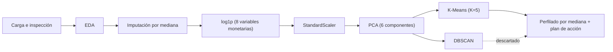

<div align="center">

# 💳 Segmentación de Clientes y Perfilado de Riesgo Financiero
### K-Means + PCA vs. DBSCAN sobre una cartera de 8 950 tarjetas de crédito

---

## 📑 Tabla de Contenidos

1. [Descripción General](#-descripción-general)
2. [Estructura del Repositorio](#-estructura-del-repositorio)
3. [Dataset y Fuentes de Datos](#-dataset-y-fuentes-de-datos)
4. [Metodología y Flujo de Trabajo](#-metodología-y-flujo-de-trabajo)
5. [Resultados e Insights Principales](#-resultados-e-insights-principales)
6. [Requisitos e Instalación](#-requisitos-e-instalación)
7. [Cómo Ejecutar el Proyecto](#-cómo-ejecutar-el-proyecto)
8. [Conclusiones y Próximos Pasos](#-conclusiones-y-próximos-pasos)
9. [Contacto / Autor](#-contacto--autor)

---

## 🎯 Descripción General

Este proyecto aplica **aprendizaje no supervisado** para segmentar a **8 950 titulares de tarjeta de crédito** a partir de **17 variables de comportamiento transaccional** (saldo, compras, anticipos de efectivo, pagos, límite de crédito, antigüedad, etc.).

**Problema de negocio.** Una entidad financiera que trata a todos sus clientes por igual desperdicia efectividad en sus campañas de marketing y detecta tarde los comportamientos de riesgo. El objetivo es descubrir **patrones de uso no evidentes** y agruparlos en **segmentos homogéneos, interpretables y accionables**.

**Enfoque.** Pipeline completo de ciencia de datos: calidad de datos → EDA → imputación y transformación → escalado → **PCA** → **K-Means** (K elegido con codo y silueta) → contraste con **DBSCAN** → **perfilado comercial** con plan de acción por segmento.

**Resultado clave.**

| Indicador | Valor |
| :--- | :--- |
| Clientes analizados | **8 950** |
| Variables de entrada | **17** (16 tras eliminar el identificador) |
| Componentes principales retenidos | **6** (≈ **80.4 %** de la varianza) |
| Modelo final | **K-Means, K = 5** |
| Silueta del modelo final | **≈ 0.26** (estructura moderada) |
| Alternativa descartada | **DBSCAN** (1 macro-clúster + 55 puntos de ruido) |

---

## 🗂️ Estructura del Repositorio

```text
.
├── Customer_Segmentation___Financial_Risk_Profiling_K-Means___PCA_vs__DBSCAN.ipynb   # Análisis completo (EDA → modelado → perfilado)
├── CC_GENERAL.csv                       # Dataset de entrada (8 950 clientes × 18 columnas)
└── README.md                            # Este documento
```

| Archivo | Descripción |
| :--- | :--- |
| `*.ipynb` | Notebook en español, organizado en 8 secciones: configuración, calidad de datos, EDA, preprocesamiento + PCA, K-Means, DBSCAN, perfilado comercial y conclusiones. |
| `CC_GENERAL.csv` | Resumen del uso de la tarjeta por titular. El notebook lo lee como `CC GENERAL.csv` (con espacio); ver [Cómo Ejecutar](#-cómo-ejecutar-el-proyecto). |
| `resumen_profiling_clusters.csv` | Medianas por segmento, tamaño y peso en la cartera. Lo exporta el propio notebook. |
| `requirements.txt` | Librerías necesarias para reproducir el análisis. |

---

## 📊 Dataset y Fuentes de Datos

Conjunto público de uso de tarjetas de crédito (`CC GENERAL`), con **una fila por titular activo**.

| Característica | Detalle |
| :--- | :--- |
| Registros | **8 950** clientes |
| Columnas | **18** (17 numéricas + `CUST_ID`) |
| Duplicados | **0** |
| Valores nulos | `MINIMUM_PAYMENTS`: 313 (≈ 3.50 %) · `CREDIT_LIMIT`: 1 registro |
| Naturaleza | Foto estática, sin dimensión temporal ni etiquetas (*ground truth*) |

### Variables clave

| Grupo | Variables |
| :--- | :--- |
| **Saldo y capacidad** | `BALANCE`, `BALANCE_FREQUENCY`, `CREDIT_LIMIT`, `TENURE` |
| **Compras** | `PURCHASES`, `ONEOFF_PURCHASES`, `INSTALLMENTS_PURCHASES`, `PURCHASES_FREQUENCY`, `ONEOFF_PURCHASES_FREQUENCY`, `PURCHASES_INSTALLMENTS_FREQUENCY`, `PURCHASES_TRX` |
| **Efectivo** | `CASH_ADVANCE`, `CASH_ADVANCE_FREQUENCY`, `CASH_ADVANCE_TRX` |
| **Pagos y solvencia** | `PAYMENTS`, `MINIMUM_PAYMENTS`, `PRC_FULL_PAYMENT` |
| **Identificador** | `CUST_ID` (se elimina antes del modelado) |

### Procesamiento inicial

- Eliminación de `CUST_ID` (no aporta comportamiento y distorsionaría las distancias).
- Imputación por **mediana** de `MINIMUM_PAYMENTS` y `CREDIT_LIMIT`.
- Detección de una anomalía: `CASH_ADVANCE_FREQUENCY` alcanza **1.5** (una frecuencia debe estar en [0, 1]); se trunca en 1.0.

---

## 🔬 Metodología y Flujo de Trabajo



### 1. EDA y calidad de datos
- Distribuciones con **fuerte asimetría positiva** y abundantes *outliers* en variables monetarias y contadores.
- Los *outliers* **no se eliminan**: corresponden a clientes genuinos de alto gasto o deuda, precisamente los segmentos de mayor interés para el negocio.
- **18 parejas** de variables con correlación ≥ 0.5 → **multicolinealidad** (p. ej., `PURCHASES` ↔ `ONEOFF_PURCHASES` ≈ 0.92; `PURCHASES_FREQUENCY` ↔ `PURCHASES_INSTALLMENTS_FREQUENCY` ≈ 0.86). Es la justificación directa de PCA.

### 2. Preprocesamiento y *feature engineering*
Orden deliberado del *pipeline*: **imputar → transformar → escalar → PCA**.

| Paso | Técnica | Motivo |
| :--- | :--- | :--- |
| Imputación | Mediana | Robusta frente a *outliers* |
| Transformación | `np.log1p` en `BALANCE`, `PURCHASES`, `ONEOFF_PURCHASES`, `INSTALLMENTS_PURCHASES`, `CASH_ADVANCE`, `CREDIT_LIMIT`, `PAYMENTS`, `MINIMUM_PAYMENTS` | Corrige asimetría y admite ceros legítimos |
| Escalado | `StandardScaler` | Evita que dominen las variables de mayor varianza |
| Reducción de dimensión | `PCA(n_components=6)` | Elimina redundancia; retiene ≈ 80.4 % de la varianza |

### 3. Modelado
- **K-Means** sobre el espacio PCA, con `n_init=10` y `random_state=42`. Selección de K mediante **método del codo** y **coeficiente de silueta** (K = 2…9).
- **DBSCAN** como contraste basado en densidad: `min_samples = 2 × dimensión = 12` y `eps = 2`, estimado con el gráfico *k-distance*.

### 4. Evaluación y perfilado
- Métricas internas (inercia, silueta) y, sobre todo, **interpretabilidad y utilidad comercial**.
- Perfilado en **unidades originales** con la **mediana** por clúster (describe al cliente típico, sin sesgo de extremos).

---

## 📈 Resultados e Insights Principales

### Selección de K (K-Means sobre 6 PCs)

| K | Inercia | Silueta |
| :---: | ---: | ---: |
| 2 | 89 372 | **0.2679** |
| 3 | 71 717 | 0.2620 |
| 4 | 62 724 | 0.2615 |
| **5** | **56 066** | **0.2606** |
| 6 | 50 037 | 0.2589 |
| 7 | 46 137 | 0.2560 |
| 8 | 43 081 | 0.2607 |
| 9 | 40 238 | 0.2423 |

> La silueta es prácticamente plana entre K = 3 y K = 8 (el repunte de K = 8 supera a K = 5 en menos de 0.001) y la inercia no muestra un codo nítido. Se eligió **K = 5** como equilibrio entre rigor estadístico y granularidad accionable (K = 2 maximiza la silueta, pero resulta demasiado burdo para uso comercial).

### Varianza explicada por PCA

| Componentes | 1 | 2 | 3 | 4 | 5 | **6** | 7 |
| :--- | ---: | ---: | ---: | ---: | ---: | ---: | ---: |
| Varianza acumulada | 29.9 % | 51.8 % | 61.1 % | 68.8 % | 75.3 % | **80.4 %** | 84.6 % |

### Segmentos finales (K-Means, K = 5)

Medianas calculadas sobre las variables originales, tal como las devuelve la tabla de perfilado del notebook.

| Clúster | Clientes | % Cartera | Perfil comercial | Rasgos (mediana) | Acción prioritaria |
| :---: | ---: | ---: | :--- | :--- | :--- |
| **0** | 2 695 | 30.11 % | **Inactivos / *Revolvers* pasivos** | Compras = 0; saldo 1 439; anticipos de efectivo 939 | Campañas de reactivación y *cashback* |
| **1** | 2 006 | 22.41 % | **VIP / *High Spenders*** | Compras 1 963; frecuencia de compra 1.00; límite 6 000; pagos 1 829 | Fidelización *premium* / tarjeta *Black* |
| **2** | 892 | 9.97 % | **Efectivo / Alto riesgo** | Saldo 3 815; anticipos 3 215; frecuencia de efectivo 0.50; pagos mínimos 1 298 | Gestión de riesgo y refinanciación |
| **3** | 1 309 | 14.63 % | **Bajo uso / *Low Engagement*** | Saldo 22; compras 177; frecuencia 0.20 | *Onboarding* y vinculación digital |
| **4** | 2 048 | 22.88 % | **Compradores a plazos** | Compras en cuotas 419 vs. 0 en pago único; frecuencia 0.92; límite 2 000 | Promociones 0 % interés y revisión de límite |

### DBSCAN: por qué se descarta

| Resultado | Detalle |
| :--- | :--- |
| Clústeres reales | **1** macro-clúster con **8 895** clientes (99.4 %) |
| Ruido (`-1`) | **55** clientes (0.6 %) |
| Diagnóstico | La densidad es **continua**: los hábitos de consumo forman un degradado sin vacíos que delimiten grupos naturales, de modo que DBSCAN enlaza transitivamente toda la masa de datos. |

### Insights de negocio

- 🔴 **Riesgo:** el clúster 2 (≈ 10 %) combina saldos altos, uso intensivo de efectivo y pagos mínimos elevados → prioridad para seguimiento y refinanciación.
- 🟢 **Valor:** el clúster 1 (≈ 22 %) concentra el mayor gasto con frecuencia de compra plena → candidato a programas de fidelización *premium*.
- 🟡 **Oportunidad:** el clúster 0 (≈ 30 %, el mayor) no realiza compras pero mantiene saldo y usa efectivo → principal palanca de reactivación.
- 📉 **Lectura honesta de la silueta (≈ 0.26):** los segmentos son **particiones útiles de un continuo**, no grupos con fronteras naturales.

> **Nota de reproducibilidad.** Los resultados de este README se verificaron re-ejecutando el *pipeline* (`random_state=42`). Los identificadores de clúster de K-Means son arbitrarios: la tabla interpretativa de la sección 7.1 del notebook usa una numeración distinta de la que produce la tabla de medianas de la sección 7. En este README se usan los **identificadores reales de la salida del modelo**.

---

## ⚙️ Requisitos e Instalación

**Requisitos previos:** Python 3.10 o superior y `git`.

### 1. Clonar el repositorio

```bash
git clone https://github.com/TU_USUARIO/NOMBRE_DEL_REPOSITORIO.git
cd NOMBRE_DEL_REPOSITORIO
```

### 2. Crear y activar un entorno virtual

```bash
# Linux / macOS
python -m venv .venv
source .venv/bin/activate

# Windows (PowerShell)
python -m venv .venv
.venv\Scripts\Activate.ps1
```

### 3. Instalar dependencias

Crea un `requirements.txt` con el siguiente contenido:

```text
numpy
pandas
matplotlib
seaborn
plotly
scikit-learn
jupyter
```

Y ejecuta:

```bash
pip install -r requirements.txt
```

---

## ▶️ Cómo Ejecutar el Proyecto

### Opción A: Local

> ⚠️ El notebook carga el dataset con `pd.read_csv("CC GENERAL.csv")`. Renombra el archivo o ajusta esa línea para que coincidan.

```bash
# Opción 1: renombrar el CSV al nombre que espera el notebook
cp CC_GENERAL.csv "CC GENERAL.csv"

# Opción 2: editar la celda de carga
# df = pd.read_csv("CC_GENERAL.csv")

jupyter notebook "Customer_Segmentation___Financial_Risk_Profiling_K-Means___PCA_vs__DBSCAN.ipynb"
```

Ejecuta **Kernel → Restart & Run All**. Al finalizar se genera `resumen_profiling_clusters.csv` en el directorio de trabajo.

### Opción B: Google Colab

1. Abre [Google Colab](https://colab.research.google.com/) y selecciona **Archivo → Subir cuaderno**.
2. Sube el `.ipynb`.
3. Sube `CC_GENERAL.csv` desde el panel de archivos (📁) y ajusta la ruta en la celda de carga.
4. Ejecuta **Entorno de ejecución → Ejecutar todo**. Colab ya incluye todas las dependencias necesarias.

---

## 🧭 Conclusiones y Próximos Pasos

### Valor aportado

- Segmentación **reproducible, interpretable y accionable** con plan de acción por segmento.
- Justificación técnica documentada de cada decisión (imputación, `log1p`, escalado, PCA, elección de K y descarte de DBSCAN).
- Honestidad metodológica: limitaciones y supuestos declarados explícitamente (foto estática, ausencia de *ground truth*, perfiles por mediana).

### Mejoras futuras

| Prioridad | Mejora | Motivo |
| :---: | :--- | :--- |
| 🔴 | Aplicar el truncado de `CASH_ADVANCE_FREQUENCY` **antes** de la transformación y el escalado | Hoy se aplica tras generar el espacio PCA, por lo que no afecta al entrenamiento |
| 🔴 | Unificar la estimación de ε con el ajuste de DBSCAN | El gráfico *k-distance* incluye la columna de etiquetas de K-Means; el ajuste final no |
| 🟠 | Comparar K-Means con **Gaussian Mixture Models**, **clustering jerárquico** o **K-Prototypes** | Probar fronteras no esféricas y asignaciones probabilísticas |
| 🟠 | Estudiar la sensibilidad de DBSCAN a `eps` y `min_samples`; usar **HDBSCAN** | Un ε menor podría fragmentar la masa densa |
| 🟠 | Validar estabilidad con *bootstrap* y **ARI** entre ejecuciones | Cuantificar la robustez de los segmentos |
| 🟡 | Incorporar la dimensión temporal | Analizar migración entre segmentos y evolución del riesgo |
| 🟡 | Convertir el modelo en un *pipeline* de `scikit-learn` desplegable (API o *dashboard*) | Llevar la segmentación a producción |

---

## 👤 Contacto / Autor

**Tu Nombre** — Data Scientist

[](https://github.com/TU_USUARIO)
[](https://www.linkedin.com/in/TU_PERFIL)
[](https://tu-sitio.com)

---

<div align="center">

⭐ Si este proyecto te resulta útil, considera darle una estrella al repositorio.

</div>
